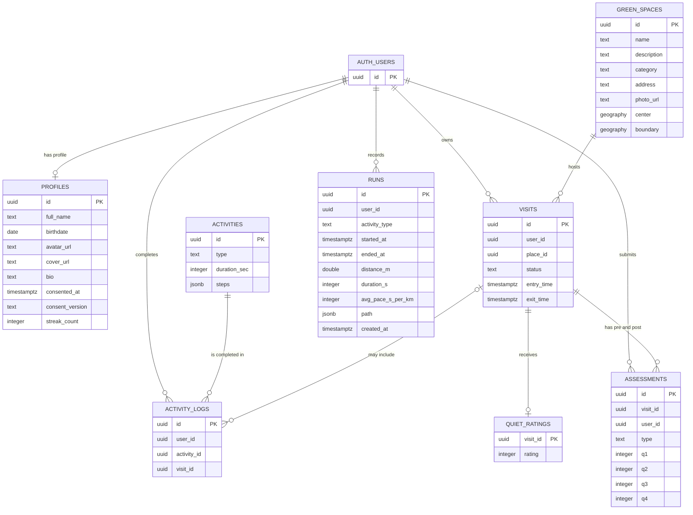
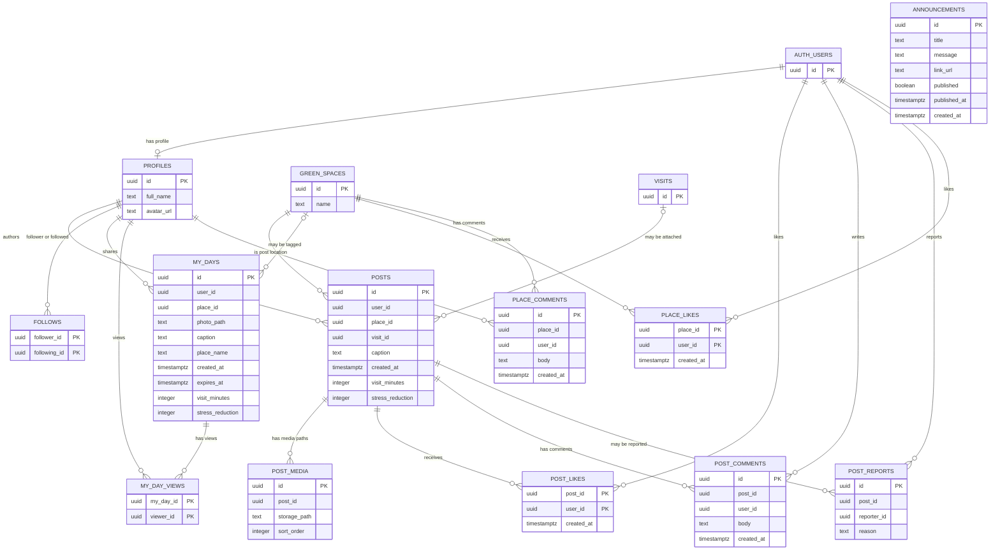
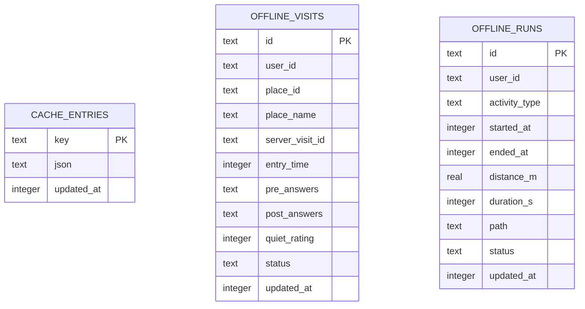
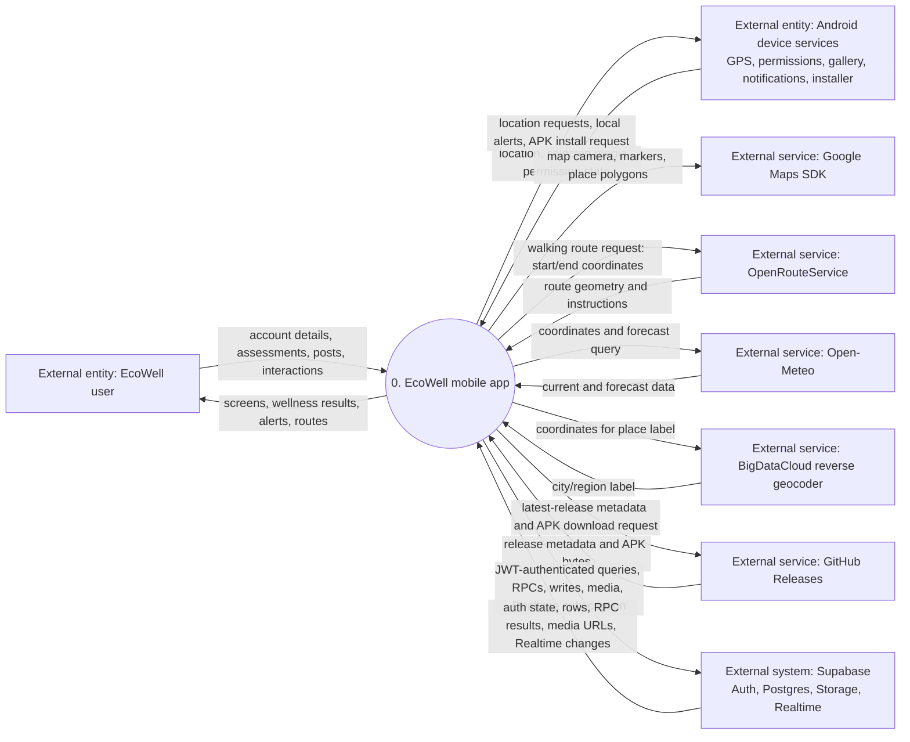
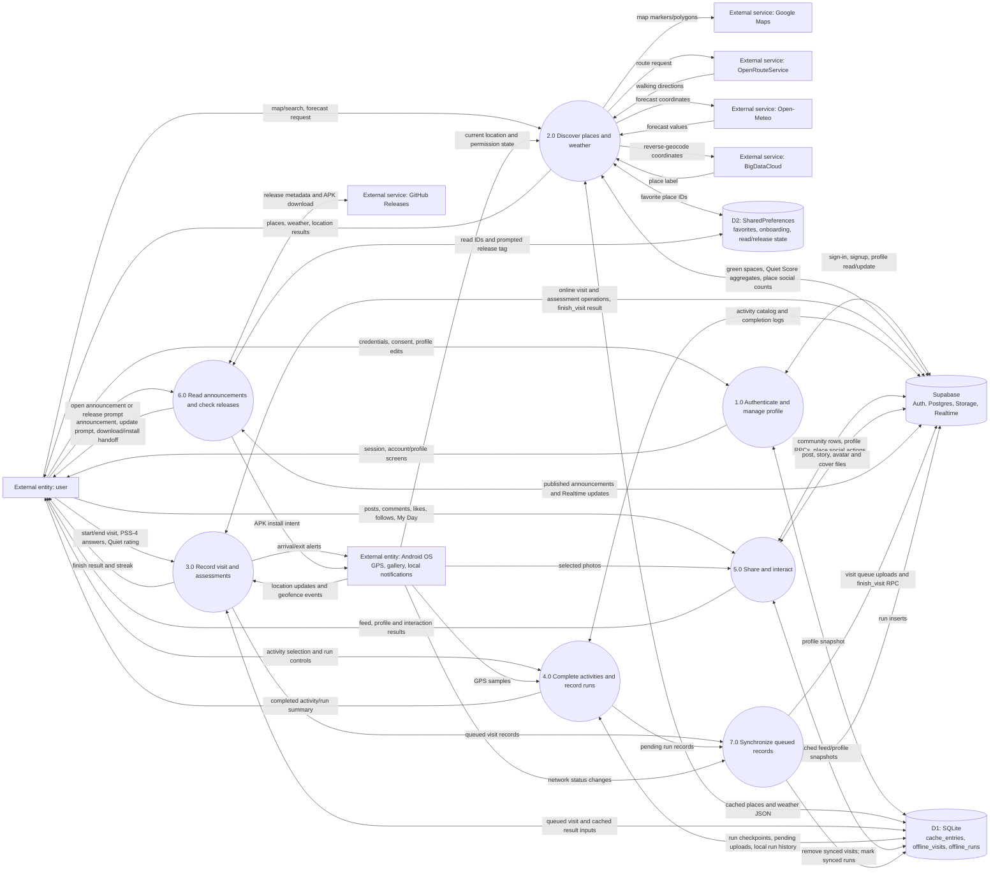

# EcoWell ERD and DFD

These diagrams describe the current Flutter app and the Supabase objects it
uses. They were prepared from the Dart source, the six checked-in SQL scripts,
the project documentation, and the Android app configuration. Build output and
dependency caches are not part of the diagrams.

## Reading the diagrams

- **Defined in checked-in SQL** means a table's DDL is present in `supabase/`.
- **App-referenced** means Dart code reads or writes the object, but its table
  definition is not present in the checked-in SQL.
- **Plan-only** means the object is described in `PLAN.md` but is not defined by
  the checked-in SQL. Confirm these objects against the live Supabase project
  before using the diagrams as a database migration specification.
- For app-referenced entities, columns reflect fields used by Dart or an RPC
  contract. Primary-key markers on entities without checked-in DDL are logical
  identifiers and must be verified against the live schema.
- Relationship lines show logical ID links used by the app. Where the source
  schema is absent, they do not assert that a database foreign-key constraint
  exists.

The current app directly calls Open-Meteo, BigDataCloud, OpenRouteService, and
GitHub Releases. The AI coach, server-side weather suggestions, and remote
push-notification services described in the development plan are not shown as
implemented flows.

## ERD: identity and wellness

`RUNS` is defined in `supabase/runs.sql`. The shown profile columns include
fields used by the app and additions in `supabase/user_profile.sql`; the base
profile DDL is not checked in. `VISIT_SUMMARIES` and
`GREEN_SPACES_WITH_STATS` are views referenced by the app, not tables.

### Views and RPC-derived data

- `VISIT_SUMMARIES` combines visit and assessment results for visit history
  and community post composition.
- `GREEN_SPACES_WITH_STATS` supplies the average Quiet Score and rating count
  returned with green-space data.
- `get_dashboard` returns aggregate visit, streak, activity, and reduction
  metrics. Its backing schema/function definition is not checked in.
- `finish_visit` accepts the post-assessment answers and Quiet rating and
  returns the visit result. Its SQL definition is not checked in.
- `QUIET_RATINGS` is documented in `PLAN.md`; the current app submits its value
  through `finish_visit`. The exact live table columns and constraints need
  verification.

## ERD: community and announcements

`PLACE_LIKES`, `PLACE_COMMENTS`, and `ANNOUNCEMENTS` are defined in checked-in
SQL. `PROFILES`, `GREEN_SPACES`, and `AUTH_USERS` are the same entities as in
the wellness diagram. Other community tables and their constraints are
app-referenced, but their DDL is not in this repository.

Posts and My Day photos are files in the Supabase Storage `post-media` bucket;
the relational rows store paths. Profile and cover images use the `avatars`
and `covers` buckets. `PUBLIC_PROFILES` is a restricted profile view referenced
by SQL functions, not a base table.

## ERD: on-device persistence

SQLite is a separate local store, not a replica with enforced foreign keys.
Offline visit/run rows are queued or retained for local history. `CACHE_ENTRIES`
stores JSON snapshots. SharedPreferences stores small device settings and
read/favorite state.

## DFD Level 0: system context

## DFD Level 1: implemented app data flows

### Important implementation notes

- Visits are saved locally when offline and uploaded when connectivity returns.
  A finished visit is sent as a visit row, pre-assessment, then `finish_visit`.
- Runs are written to SQLite first, then inserted into `runs`; the same run ID
  is used for retries.
- Previously fetched green spaces, selected profile/feed/dashboard data, and
  weather can be read from SQLite while offline. Favorites and several UI
  flags are in SharedPreferences.
- Community actions such as likes/comments require a server connection; their
  returned data is not modeled as an offline write queue.
- Location samples are used on-device for visits and run recording. Run paths
  are uploaded as `runs.path`.
- The Android app uses local notifications for arrival/exit alerts. The
  checked-in implementation does not show a remote push-notification flow.
